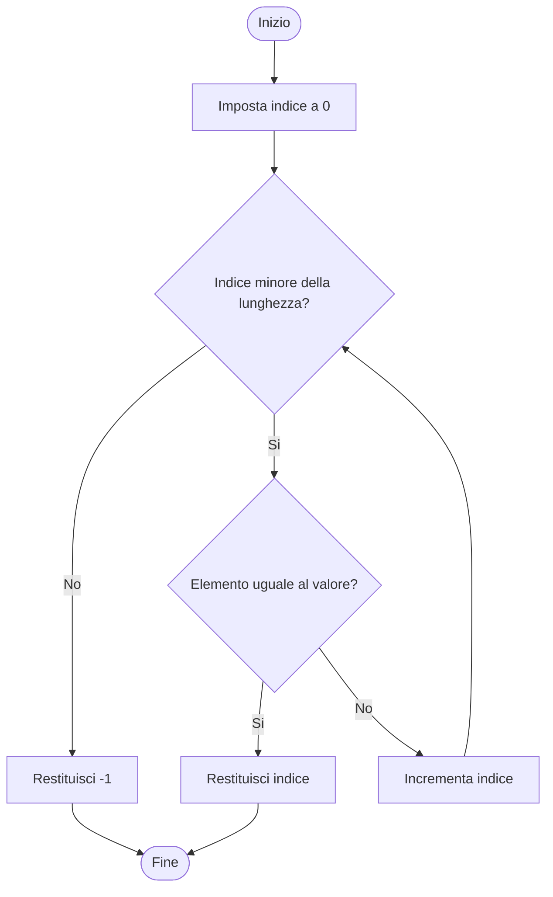

# Ricerca sequenziale in un array

La ricerca sequenziale esamina gli elementi di un array da sinistra verso destra. Nell'esempio l'array contiene `{7, 6, 8, 5, 9}` e il valore cercato è `8`, che si trova all'indice `2`.

```java
public static int cerca(int[] valori, int cercato) {
    for (int indice = 0; indice < valori.length; indice++) {
        if (valori[indice] == cercato) {
            return indice;
        }
    }
    return -1;
}
```



Se l'elemento cercato non è presente, il ciclo arriva alla fine dell'array senza trovare corrispondenze. Il metodo restituisce `-1`, un valore che segnala l'assenza dell'elemento.
