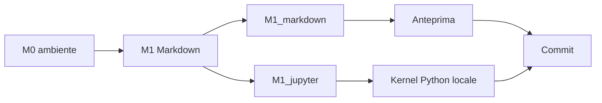

# Informatica - Quercioli Martino (4Bi)

- **Studente:** Martino Quercioli
- **Classe:** 4Bi
- **Materia:** Laboratorio di Informatica
- **Anno Scolastico:** 2026-2027
- **Docente di Laboratorio:** Andrea Trentini

---

## Scopo del Repository
Questo repository raccoglie tutto il lavoro svolto durante le esercitazioni del corso di **Laboratorio di Informatica** per l'anno scolastico 2026-2027. Contiene i codici sorgente, le verifiche dell'ambiente di lavoro, i report in Markdown e le consegne relative ai singoli moduli didattici affrontati durante l'anno.

---

## Convenzione di Denominazione delle Cartelle
La struttura del repository segue la convenzione stabilita per il corso. Ciascuna cartella di modulo è nominata nel seguente formato:

`M<N>_<descrizione>`

- **`M<N>`**: Identificativo del modulo, da `M0` a `M8`
- **`<descrizione>`**: Tema principale trattato nel modulo in lettere minuscole e separate da trattini bassi.

---

## Struttura delle Cartelle e Consegne
Le consegne di ciascun modulo sono collocate nella rispettiva cartella dedicata nella radice del repository:

```text
.
├── .gitignore
├── README.md
├── M0_ambiente/
│   ├── versioni.md
│   ├── percorsi.md
│   ├── orario.py
│   ├── esecuzione.md
│   └── configurazione_git.md
├── M1_markdown/
│   ├── img/
│   └── ...
├── M1_jupyter/
│   └── ...
├── M2_...
└── M8_concorrenza_rete/
```

## Stato dei moduli

| Modulo | Cartella | Stato |
|---|---|---|
| M0 | `M0_ambiente/` | Completato |
| M1 Markdown | `M1_markdown/` | In svolgimento |
| M1 Jupyter | `M1_jupyter/` | In svolgimento |
| M2-M8 | Cartelle dedicate | Da svolgere |

## Apertura del repository

Clona il repository e spostati nella cartella locale:

```bash
git clone <URL_DEL_REPOSITORY>
cd Informatica-Quercioli_Nome-4Bi-Python
```

Apri i documenti Markdown con Visual Studio Code e usa l'anteprima. Apri i
notebook `.ipynb` con VS Code o Jupyter locale, seleziona il kernel Python 3 e
riavvia il kernel prima di eseguire tutte le celle.

## Convenzioni

Nomina le cartelle con il formato `M<N>_<descrizione>` e mantieni i file di
ciascun modulo nella cartella corrispondente. Scrivi i messaggi di commit al
presente, senza punto finale, con il riferimento all'esercizio. Non versionare
password, file temporanei, `.ipynb_checkpoints/` o HTML e PDF generati.
Conserva gli output dei notebook quando la consegna richiede di documentare la
verifica; cancellali solo per una conversione esplicitamente richiesta.



## Autore e licenza

Autore: Martino Quercioli. Contatto istituzionale: account scolastico del
corso. Licenza: MIT License.